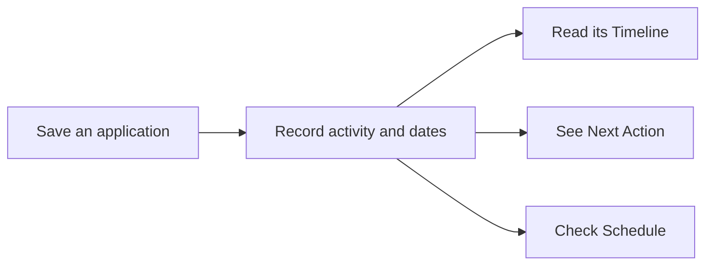

# How JobTracker works

JobTracker helps a job seeker answer three questions: **Where have I applied?
What has happened? What should I do next?** Applications and activity are saved
to the database and belong to the signed-in user.

## A typical session

1. Sign in with Clerk and open **Applications**.
2. Add a company and job title. Save a draft or choose the current hiring status.
3. Open the application to add notes, edit details or **Record activity**.
4. Use **Next Action** to see the suggested next step and **Schedule** to see dates.
5. Return to **Dashboard** for an overview of the job search.

Recording activity can also change the application status. For example, recording
an interview sets it to Interviewing. Suggestions themselves never change status.

## Pages

| Page | What it is for |
| --- | --- |
| Dashboard | Counts, active hiring processes, priority actions and a Schedule summary. |
| Applications | Add applications; search by company or job title; filter and sort. |
| Application Details | Read and edit the application, record activity, view Timeline or delete. |
| Schedule | Recorded deadlines and interviews, plus a separate Suggested attention section. |
| Insights | Current status distribution, progress beyond Applied and saved-data coverage. |
| Settings | Working light/dark theme controls; profile, tracking and export controls are previews. |

The desktop sidebar becomes a navigation drawer on smaller screens. The app opens
on Dashboard. Signing out hides the workspace and clears its cached application data.

Signed-out users see Clerk's sign-in component directly on the page, without an
extra button or modal. The page and form follow the selected light/dark theme.
Google, password, recovery and sign-up options remain controlled by Clerk.
The embedded component uses hash routing for its steps and Dashboard as the
fallback destination after authentication.

Application cards and action lists lead with the job title and show the company
below it. Dashboard places that identity before the suggested task. Details shows
Next Action and Timeline before Description & notes. Its Quick facts groups Dates,
Contact and saved Reference information; missing optional fields remain available
inside **Missing optional details**. **Add details** opens the usual Edit form.
These fields are optional reference information, with no completeness score.

## Adding and editing

Only **Company** and **Job title** are required. The shared Add/Edit form has five
sections:

| Section | Contents |
| --- | --- |
| Basic Info | Company, job title, job URL and location. |
| Application | Status, Applied date, Application due date, source and application method. |
| Contact | Contact person, email and follow-up preference; expandable. |
| Job Description | Saved advertisement text with Analyze description, Clean formatting and Undo. |
| More details | Salary range and personal notes; expandable. |

Contact and More details start collapsed when adding. Edit opens them when saved
values need to be shown. Collapsing a section preserves its fields.

Applied date appears for submitted or later statuses, or whenever it already has
a value. Changing status never inserts or clears that date. **Application due
date** is the deadline for sending the application, separate from interview,
assignment and offer dates.

When a web page copies a real HTML list, pasting into Job Description restores
the list markers that a plain text field would otherwise lose. Existing pasted
text and spacing are kept for review. Clean formatting removes pasted Markdown
emphasis and line-break artifacts,
normalizes bullet symbols to `-`, and keeps at most one blank line between text
sections. It adds space around headings and lists. After clearly labeled
requirements or benefits sections, consecutive unmarked items also become
`-`-bullets. It preserves the wording and nested-list indentation, and affects
only the unsaved job description. Undo restores the previous text until another
manual description edit is made.

**Analyze description** is available when the Job Description contains text. It
looks for explicit company, job title, location, application due date, contact
email, contact person, source and salary range facts in
Finnish or English adverts, including a limited set of clear narrative phrases.
Review each suggestion and its source excerpt, then
select the values to copy into the unsaved form. Existing filled fields are not
selected for replacement by default. **Cancel** leaves the form unchanged.
Technologies and work arrangements appear only under **Detected in description**;
they are not stored as separate fields. Analysis does not save the application or
change the description or personal Notes. If nothing clear is found, enter details
manually. Analysis accepts up to 20,000 characters; this limit does not restrict
saving the description itself.

Contact details require an explicit contact cue; privacy addresses are excluded.
Source may come from a Source/Lähde label or the listing header's Duunitori
links. Salary suggestions require a stated pay amount and currency. Ambiguous
or conflicting values stay out of the suggestions.

Some job boards include publication dates, listing end labels, or relative text
such as “3 days left”. A concrete **Ends** date is suggested for **Application
due date**. If its year is missing, analysis infers the year from the publication
date and today's local date; the review marks it as inferred so you can check it
before applying. For example, `Published 12.10. (Ends 12.4.)` analyzed on
15.10.2026 suggests 12.4.2027. If the employer states a different deadline,
the listing's **Ends** date is suggested and the employer date is shown separately
for review. A relative countdown alone stays informational because it has no
exact calendar date.
The same date matching also recognizes Finnish **Julkaistu**, **Päättyy**,
**Haku päättyy** and **Hakuaika päättyy** labels. For example,
`Julkaistu 12.10. (Päättyy 12.4.)` suggests 12.4.2027 when analyzed on
15.10.2026, with the inferred year called out for review.

Saving persists changes through the API. If saving fails, the form keeps its
values and shows an error. Deletion requires confirmation and removes the
application and its Timeline events.

Closing Add/Edit or Record activity with unsaved changes asks whether to keep
editing or discard them. Cancel, Escape and clicking outside the dialog use the
same confirmation. An unchanged form closes directly.

## Status, activity and next steps

The nine statuses are Draft, ToApply, Applied, Interviewing, Assignment, Offer,
Rejected, Ghosted and Withdrawn. Users can update status directly or record an
activity that moves the application to the corresponding stage.

**Timeline** shows saved facts: application creation and sending, status changes,
follow-ups, recruiter replies, interviews, assignments and offers. Ordinary notes
edits do not count as contact.

**Next Action** combines the current status with that history. Examples:

- A draft suggests finishing the application.
- An Applied application suggests waiting, following up or reviewing its status.
- A recorded future interview suggests preparing for it.
- A submitted assignment suggests waiting for feedback.
- Closed applications have no next action.

Follow-up is suggested after 14 days without newer contact only when a valid
contact email exists and the preference allows it. After 30 days, the suggestion
becomes **Review status**. The user decides whether to keep it active or mark it
as Ghosted; the app never marks it automatically.

See [workflow rules](application-workflow.md) for exact timing, stage changes and
date handling.

## Schedule and summaries

Schedule separates **hard dates** from **suggested attention**. Hard dates come
from application deadlines and recorded interview, assignment and offer dates.
They are grouped into overdue, today and upcoming. Follow-up and status-review
suggestions appear separately; they are not overdue commitments.

There is no separate reminder editor, completion action, snooze or background
notification service. Schedule is calculated from application data each time it
is rendered.

The Applications **Active** filter includes Draft and ToApply. Dashboard's
**Active hiring processes** counts only Applied, Interviewing, Assignment and
Offer. **Archived** is a filter for Rejected, Ghosted and Withdrawn, not a
separate archive operation.

Insights' **Current hiring stages** shows the share of active hiring processes currently
in Interviewing, Assignment or Offer. It is a current-status summary, not a
historical response-rate measurement. It shows the count and denominator, and
links suggested next steps directly to their applications. Saved context fields
are optional reference information, not a completeness target.

## Where the data lives

The deployed frontend runs on Vercel, the API on Railway and the database on Neon
PostgreSQL. Local development defaults to SQLite. The browser caches API responses;
reloading fetches persisted data again. Theme choice is stored in the browser.

The API validates Clerk sessions and limits every application query to the
current owner. Signing in never imports old demo data or another user's records.

For implementation details, see [architecture](architecture.md). For current
limitations and possible additions, see [roadmap](roadmap.md).
